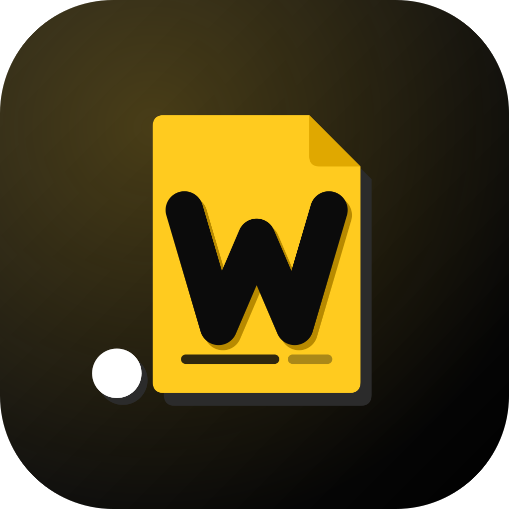

<p align="center"></p>

# .WORKS

**Traitement de texte compatible Microsoft Word (.docx) pour Android** — développé par **SuperEssence Studio**.

- Importe n'importe quel fichier Word `.docx` : mise en page, polices, styles, tableaux, listes, en-têtes / pieds de page, images, sauts de page… sont affichés comme dans Word PC (pagination réelle, règle, zoom).
- Ruban façon Word avec les onglets **Accueil, Insertion, Mise en page, Références, Révision, Affichage** :
  - **Accueil** : coller / couper / copier, reproduire la mise en forme, police, taille, agrandir / réduire, gras, italique, soulignements (double, pointillé, ondulé…), barré / barré double, indice / exposant, casse, petites majuscules, effets (ombre, relief, contour, masqué), couleur, surlignage, trame, espacement des caractères, alignements, justifier, interligne, espacement avant / après, retraits, retrait 1re ligne / suspendu, tabulations, bordures et trame de paragraphe, enchaînements (lignes solidaires, saut de page avant…), puces, numérotation, styles (Titre 1-3, Titre, galerie complète), rechercher / remplacer, marques ¶.
  - **Insertion** : page vierge, saut de page / colonne / ligne, sauts de section, tableau, image, lien, signet, commentaire, en-tête, pied de page, numéros de page, encadré, lettrine, date et heure, champs (PAGE, NUMPAGES, AUTEUR…), ligne horizontale, symboles, filigrane (texte ou image).
  - **Mise en page** : marges (prédéfinies ou personnalisées), orientation, taille du papier (A4, A5, A3, Lettre…), colonnes, numéros de ligne, bordures de page, alignement vertical, première page / pages paires différentes.
  - **Références** : table des matières (insérer, mettre à jour, supprimer), notes de bas de page et de fin, légendes, signets, mise à jour des champs.
  - **Révision** : statistiques, commentaires, suivi des modifications, accepter / refuser, restreindre la modification.
  - **Affichage** : mode lecture, règle (en cm), marques de mise en forme, zoom, largeur de page.
- **Nouveautés 1.1** :
  - moteur **SuperDoc 2.34** (dernière version), Capacitor 8.6, Vite 8 ;
  - **modèles** prêts à l'emploi : lettre, CV, rapport, compte rendu, facture ;
  - **export PDF / impression** (mise en page identique, toutes les pages — « Enregistrer au format PDF » d'Android) ;
  - export **Markdown, HTML, texte brut** ; import de fichiers `.md`, `.html`, `.txt` ;
  - **historique des versions** (restaurer ou ouvrir une version précédente) ;
  - **volet de navigation** : plan des titres, recherche, remplacer / tout remplacer ;
  - **Mode Web** : le texte se réorganise à la largeur du téléphone ;
  - **mode concentration**, **thème sombre**, **lecture à voix haute** (synthèse vocale Android) ;
  - boutons **Annuler / Rétablir** permanents, compteur de mots et « Page x sur N » (toucher pour atteindre une page), zoom à deux doigts ;
  - récents : recherche, tri, renommer, dupliquer, épingler, partager ;
  - **paramètres** : thème, nom d'auteur, fréquence d'enregistrement auto, zoom, correcteur, écran toujours allumé ;
  - ouverture des `.docx` **protégés par mot de passe** ; raccourcis Ctrl+S / P / F / H / G.
- Enregistre en `.docx` natif : le fichier ré-ouvert dans Microsoft Word est identique (le moteur conserve le XML Word d'origine et ne réécrit que ce que tu as modifié).
- Partage direct vers Word, Drive, Gmail, WhatsApp… et « Ouvrir avec .WORKS » depuis le gestionnaire de fichiers.
- Polices métriquement compatibles embarquées (Calibri → Carlito, Cambria → Caladea, Arial → Arimo, Times New Roman → Tinos, Courier New → Cousine) pour que les lignes et les pages tombent exactement au même endroit que sur PC.

## Télécharger l'APK

Chaque push compile automatiquement l'APK (onglet **Actions** et page **Releases** du dépôt).
Ouvre la dernière release depuis ton téléphone, télécharge `WORKS-x.y.z.apk` et installe-le
(autorise « sources inconnues » si Android le demande).

## Développement

```bash
npm install
npm run dev            # version web sur http://localhost:5173
npm run icons          # régénère logo / icônes / splash depuis resources/logo-mark.svg
npm run android:sync   # build web + copie dans le projet Android
cd android && ./gradlew assembleRelease   # nécessite le SDK Android
```

### Signature

L'APK est signé avec une clé de développement incluse (`android/keystore/works-dev.jks`).
Avant une publication sur le Play Store, crée ta propre clé et ajoute-la dans les *secrets* GitHub
(`KEYSTORE_BASE64`, `KEYSTORE_PASSWORD`, `KEY_ALIAS`, `KEY_PASSWORD`) : le workflow l'utilisera automatiquement.

## Licence

Le moteur DOCX [SuperDoc](https://www.superdoc.dev) est sous licence AGPL-3.0 ; .WORKS est donc distribué sous AGPL-3.0
(code source public). Une licence commerciale SuperDoc est nécessaire pour une distribution en code fermé.

© SuperEssence Studio
