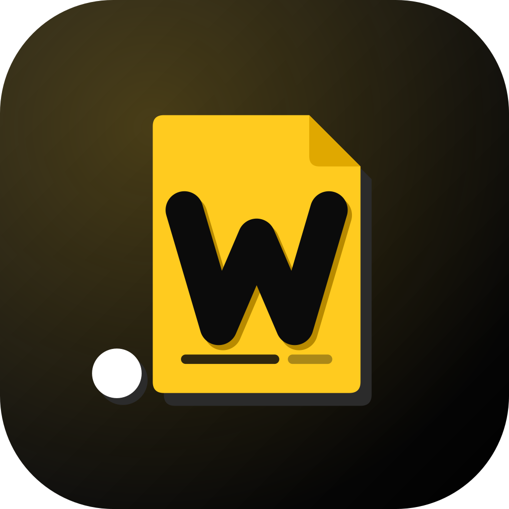

<p align="center"></p>

# .WORKS

**Traitement de texte compatible Microsoft Word (.docx) pour Android** — développé par **SuperEssence Studio**.

- Importe n'importe quel fichier Word `.docx` : mise en page, polices, styles, tableaux, listes, en-têtes / pieds de page, images, sauts de page… sont affichés comme dans Word PC (pagination réelle, règle, zoom).
- Ruban façon Word avec les onglets **Accueil, Insertion, Mise en page, Références, Révision, Affichage** :
  - **Accueil** : coller / couper / copier, reproduire la mise en forme, police, taille, agrandir / réduire, gras, italique, soulignements (double, pointillé, ondulé…), barré / barré double, indice / exposant, casse, petites majuscules, effets (ombre, relief, contour, masqué), couleur, surlignage, trame, espacement des caractères, alignements, justifier, interligne, espacement avant / après, retraits, retrait 1re ligne / suspendu, tabulations, bordures et trame de paragraphe, enchaînements (lignes solidaires, saut de page avant…), puces, numérotation, styles (Titre 1-3, Titre, galerie complète), rechercher / remplacer, marques ¶.
  - **Insertion** : page vierge, saut de page / colonne / ligne, sauts de section, tableau, image, lien, signet, commentaire, en-tête, pied de page, numéros de page, encadré, lettrine, date et heure, champs (PAGE, NUMPAGES, AUTEUR…), ligne horizontale, symboles, filigrane (texte ou image).
  - **Mise en page** : marges (prédéfinies ou personnalisées), orientation, taille du papier (A4, A5, A3, Lettre…), colonnes, numéros de ligne, bordures de page, alignement vertical, première page / pages paires différentes.
  - **Références** : table des matières (insérer, mettre à jour, supprimer), notes de bas de page et de fin, légendes, signets, mise à jour des champs.
  - **Révision** : statistiques, commentaires, suivi des modifications, accepter / refuser, restreindre la modification.
  - **Affichage** : mode lecture, règle (en cm), marques de mise en forme, zoom, largeur de page.
- **Fidélité Word / LibreOffice garantie** (couche `src/fidelity.js`) :
  - document ouvert puis enregistré sans modification → fichier rendu **identique octet pour octet** ;
  - document modifié → seules tes modifications changent : chaque partie non touchée du .docx (styles, en-têtes, numérotation, images, XML personnalisé…) est réécrite avec ses **octets d’origine** ;
  - les parties du fichier d’origine encore référencées sont restaurées si le moteur les a perdues ;
  - l’ordre des éléments XML imposé par le schéma Word est rétabli (bordures de page / paragraphe / tableau, `pPr`, `rPr`, `sectPr`…) : plus de message « Word a détecté un contenu illisible » ;
  - chaque partie XML est vérifiée avant l’écriture : un fichier corrompu n’écrase jamais ton document ;
  - testé avec le validateur officiel Microsoft (Open XML SDK) et LibreOffice (rendu PDF identique hors modifications), sur des fichiers créés par Word, LibreOffice et python-docx : champs, contrôles de contenu, zones de texte, équations, notes, commentaires, suivi des modifications, table des matières.
- **Enregistrer = écraser le fichier d’origine** (Android) : un .docx ouvert depuis Fichiers, Drive, Téléchargements… est réenregistré à sa place ; il se rouvre tel quel dans Word ou LibreOffice. « Enregistrer sous… » utilise le sélecteur Android (Téléchargements, Drive, carte SD…).
- **Édition mobile complète** :
  - barre de mise en forme au-dessus du clavier : style, police, taille, gras, italique, souligné, barré, couleur, surlignage, puces, numérotation, retraits, alignement / interligne, insertion (tableau, image, lien, commentaire, note, saut de page, numéros de page, date, symbole, table des matières), effacer la mise en forme — avec l’état actif en direct ;
  - outils de tableau contextuels (ajouter / supprimer lignes et colonnes, fusionner, fractionner, supprimer) ;
  - annuler / rétablir dans la barre de titre ;
  - zoom « Texte » (la colonne de texte remplit l’écran), zoom « Page », pincer pour zoomer ;
  - quand le clavier est ouvert, le ruban se replie pour laisser la place au texte.
- Partage direct vers Word, Drive, Gmail, WhatsApp… et « Ouvrir avec .WORKS » depuis le gestionnaire de fichiers.
- Polices métriquement compatibles embarquées (Calibri → Carlito, Cambria → Caladea, Arial → Arimo, Times New Roman → Tinos, Courier New → Cousine) pour que les lignes et les pages tombent exactement au même endroit que sur PC.

## Télécharger l'APK

Chaque push compile automatiquement l'APK (onglet **Actions** et page **Releases** du dépôt).
Ouvre la dernière release depuis ton téléphone, télécharge `WORKS-x.y.z.apk` et installe-le
(autorise « sources inconnues » si Android le demande).

## Vérifier la compatibilité

Menu ⋮ → **Vérifier la compatibilité** : contrôle le fichier qui sera enregistré (identique à l’original ou seules tes modifications, XML valide, ordre conforme au schéma Word).

## Développement

```bash
npm install
npm run dev            # version web sur http://localhost:5173
npm run icons          # régénère logo / icônes / splash depuis resources/logo-mark.svg
npm run android:sync   # build web + copie dans le projet Android
cd android && ./gradlew assembleRelease   # nécessite le SDK Android
```

### Signature

L'APK est signé avec une clé de développement incluse (`android/keystore/works-dev.jks`).
Avant une publication sur le Play Store, crée ta propre clé et ajoute-la dans les *secrets* GitHub
(`KEYSTORE_BASE64`, `KEYSTORE_PASSWORD`, `KEY_ALIAS`, `KEY_PASSWORD`) : le workflow l'utilisera automatiquement.

## Licence

Le moteur DOCX [SuperDoc](https://www.superdoc.dev) est sous licence AGPL-3.0 ; .WORKS est donc distribué sous AGPL-3.0
(code source public). Une licence commerciale SuperDoc est nécessaire pour une distribution en code fermé.
Attention : depuis la version 2, SuperDoc s’appuie sur le paquet `@superdoc/docx-engine`, distribué sous la
**licence propriétaire « SuperDoc DOCX Engine »** (voir `node_modules/@superdoc/docx-engine/DOCX-ENGINE-LICENSE.md`) :
vérifie ses conditions avant toute publication (Play Store notamment).

© SuperEssence Studio
