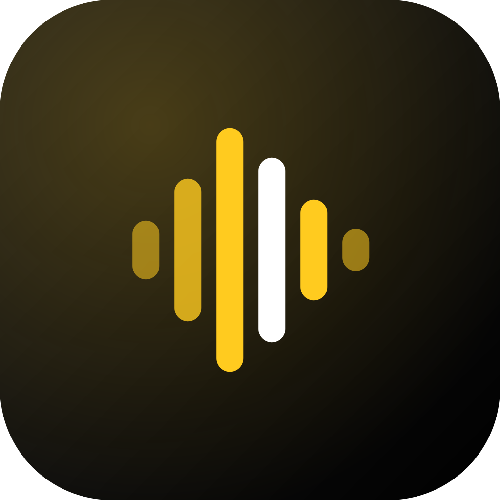

<p align="center"></p>

# .BEATS — studio audio + voix IA

App Android de **montage audio** par **SuperEssence Studio** (application séparée de .WORKS, dossier `beats/`).

## 🎚 Studio (multipiste)
- Importe autant de musiques que tu veux (MP3, WAV, M4A, AAC, OGG, FLAC, MP4…) : **nouvelle piste**, **à la suite** (assembler) ou **à la tête de lecture** (rajouter un morceau à un endroit précis).
- Clips : déplacer (glisser, même vers une autre piste), rogner les bords, **couper**, dupliquer, **boucler ×2/4/8/16**, fondus d'entrée/sortie, volume, inverser, normaliser.
- **Vitesse** (effet vinyle) ou traitement pro : **tempo seul** (time-stretch) et **tonalité seule** (pitch-shift ±12 demi-tons).
- Pistes : volume, panoramique, mute/solo, **égaliseur 3 bandes**, **réverbération**, **écho calé au tempo**, compresseur, figer la piste.
- Grille magnétique calée sur les temps, métronome, zoom (boutons ou pincement), annuler / rétablir illimité.
- **Enregistrement micro** directement sur une piste pendant la lecture.
- Export **MP3 320k / 192k** ou **WAV**, + export des pistes séparées (stems), partage direct (WhatsApp, Drive, TikTok…).
- Projets enregistrés automatiquement sur le téléphone.

## ✨ Ajouts IA automatiques
L'app **écoute ta musique** : tempo (BPM), position des temps, **tonalité**, **accords de chaque mesure** et **énergie** (couplet / refrain / drop).
Elle génère ensuite des pistes qui vont avec, dans le style choisi (**Trap, Drill, House, Pop, Lo-fi, Afro, Reggaeton, Cinématique**) :
- **Batterie** (avec roulements de charley, breaks toutes les 8 mesures),
- **Basse / 808** qui suit les accords détectés (glissés en drill),
- **Accords / nappes**, **mélodie** (motifs dans la gamme du morceau),
- **FX** : montées avant les refrains, impacts sur les drops, descentes.
« Suivre l'énergie » : calme sur les passages doux, plein volume sur les refrains. 🎲 *Varier* = nouvelle version.

Outils d'assemblage : **enchaîner façon DJ** (fondus calés sur le tempo + beatmatch), **prolonger le morceau** (rejoue le meilleur passage, calé sur les mesures),
**intro auto**, **outro auto**, **mastering auto**, **caler tous les morceaux sur le BPM**, **créer un beat de zéro**.

## 🎙 Voix IA (section séparée)
- **Cloner une voix** à partir d'un ou plusieurs MP3 (ou du micro).
- **Faire dire n'importe quel texte** à la voix clonée (multilingue, réglages de stabilité / ressemblance / expressivité).
- **Parler / chanter avec la voix clonée** : tu t'enregistres, l'intonation et la mélodie sont gardées, le timbre devient celui de la voix clonée.
- Résultat → **directement dans le Studio** pour le poser sur une musique.
- Le clonage utilise l'API **ElevenLabs** avec **ta propre clé** (gratuite pour commencer : elevenlabs.io › Developers › API Keys). La clé reste sur le téléphone.
- **Labo voix hors-ligne** (sans Internet ni clé) : imiter la hauteur d'une voix modèle, voix grave / aiguë, chipmunk, monstre, robot, radio, grande salle, chorale.

> ⚠️ Ne clone que ta voix ou celle de personnes qui t'ont donné leur accord.

## Télécharger l'APK
Chaque push qui touche `beats/` compile l'APK (workflow **Build .BEATS APK**). Ouvre la page **Releases** du dépôt
depuis ton téléphone, prends la dernière release `.BEATS 1.0.x`, télécharge `BEATS-1.0.x.apk` et installe-le.

## Développement
```bash
cd beats
npm install
npm run dev            # version web sur http://localhost:5173
npm run icons          # régénère icônes / splash depuis resources/logo-mark.svg
npm run android:sync   # build web + copie dans le projet Android
cd android && ./gradlew assembleRelease
```
Signature : clé de dev incluse (`android/keystore/beats-dev.jks`). Pour le Play Store, ajoute tes secrets GitHub
`BEATS_KEYSTORE_BASE64`, `BEATS_KEYSTORE_PASSWORD`, `BEATS_KEY_ALIAS`, `BEATS_KEY_PASSWORD`.

© SuperEssence Studio
