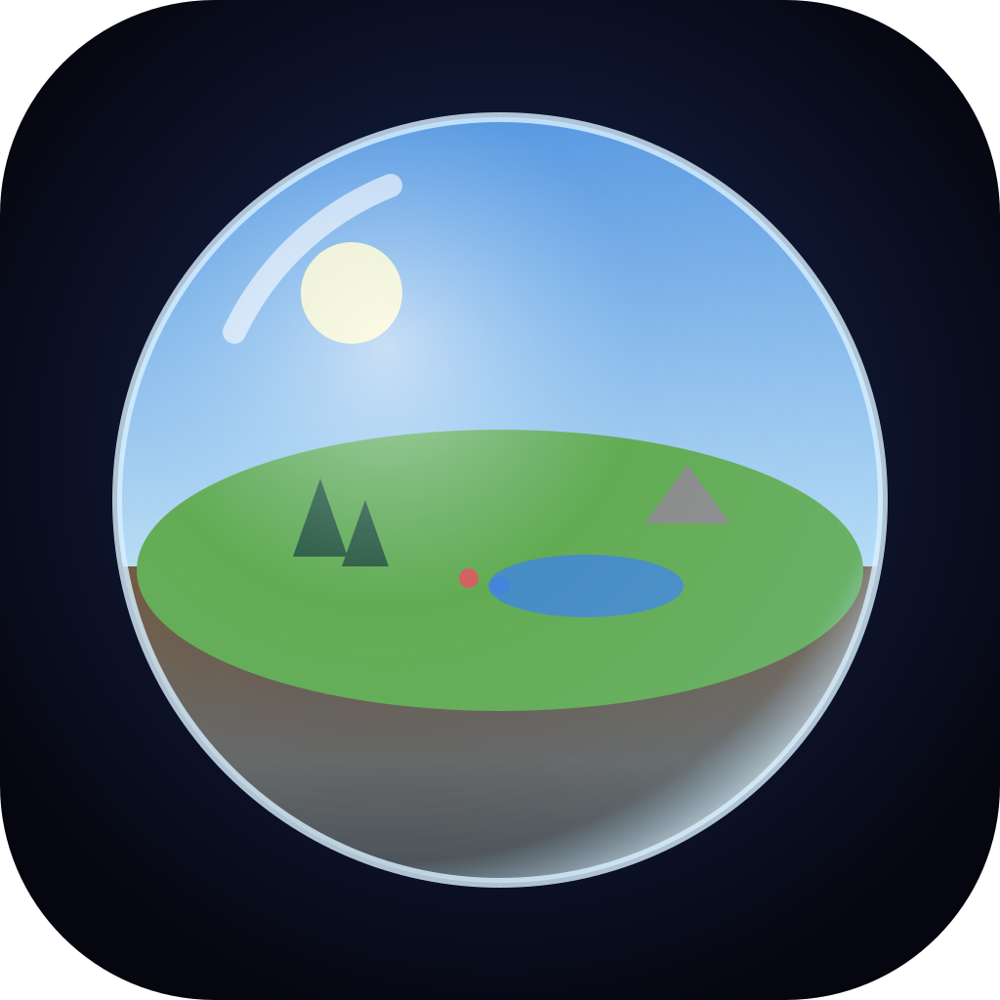

<p align="center"></p>

# La Bulle — simulation de vie 2.5D

Un monde clos, enfermé dans une sphère de verre qui flotte dans le vide. Dézoome : tu vois la bulle entière,
son soleil captif, la coupe de terre sous le sol. Zoome : la paroi s’efface et tu suis chaque être de près.

## Ce qui est simulé

- **Êtres vivants** : naissance, enfance, adolescence, âge adulte, vieillesse, mort. Faim, soif, fatigue/sommeil,
  température ressentie, santé, maladies contagieuses (immunité acquise), grossesse, accouchement, deuil.
- **Esprit** : émotions (joie, tristesse, peur, colère, amour), pensées intérieures, rêves, souvenirs,
  questions existentielles (« Qu’y a-t-il derrière la Paroi ? », « Qui nous a enfermés ? »), foi en toi,
  conscience d’être enfermé, envie de partir.
- **Liens** : conversations (météo, ragots, amour, deuil, guerre, savoir, dieu, la Paroi…), amitiés, rivalités,
  jalousie, rixes, couples, familles, orphelins recueillis, chefs de tribu, exodes et nouvelles tribus.
- **Évolution** : génome hérité des deux parents avec mutations (force, intelligence, sociabilité, agressivité,
  curiosité, fertilité, longévité, empathie, spiritualité, immunité, apparence) ; compétences apprises.
- **Civilisation** : 18 découvertes (feu, outils, langage, chasse, huttes, poterie, agriculture, médecine,
  écriture, métallurgie, astronomie, philosophie, cartographie, ingénierie, Théorie de la Bulle, Le Passage),
  ressources (nourriture, bois, pierre), huttes, maisons, greniers, champs, temples, sépultures.
- **Rivalités & guerres** : vols, chasse sur le territoire d’autrui, insultes, rixes → guerres, raids, villages
  incendiés, trêves, peuples vaincus absorbés.
- **Lois physiques** : gravité (chutes sur les pentes, projectiles balistiques), thermique (saison, heure,
  altitude, abri, feu, vêtements), cycle de l’eau, combustion propagée par le vent, faune (cerfs, lapins,
  loups prédateurs), végétation qui pousse, brûle et repousse, jour/nuit, 4 saisons, météo (pluie, orage,
  neige, brume, canicule).

## Le but

Mener la civilisation jusqu’à la **Libération** : qu’elle survive, apprenne, comprenne qu’elle vit dans une
bulle, puis construise **Le Passage** pour franchir la Paroi. 10 objectifs jalonnent la partie.

## Tu es le dieu

Pluie, soleil, foudre, feu, abondance, bénédiction, épidémie, élever/creuser le terrain, gibier, loups,
créer la vie, météore, grand froid, sécheresse, et **Révélations** (« Aimez-vous les uns les autres »,
« La Paroi n’est pas la fin du monde »…). Ton énergie divine se régénère avec leur foi et leurs prières.

Affichage du temps : heure, jour, saison, année de la bulle, durée simulée totale et temps réel écoulé.
Vitesses ⏸ ×1 ×5 ×25 ×100 ×400. Sauvegarde automatique.

## APK

Chaque push touchant `bulle/` compile l’APK (workflow **Build La Bulle APK**, onglets *Actions* et *Releases*,
tag `bulle-v1.0.N`). Télécharge `LaBulle-1.0.N.apk` sur ton téléphone et installe-le.

## Développement

```bash
cd bulle
npm install
npm run serve          # http://localhost:8080 (aucun build nécessaire : modules ES natifs)
npx cap sync android   # copie www/ dans le projet Android
cd android && ./gradlew assembleRelease
```

© SuperEssence Studio
